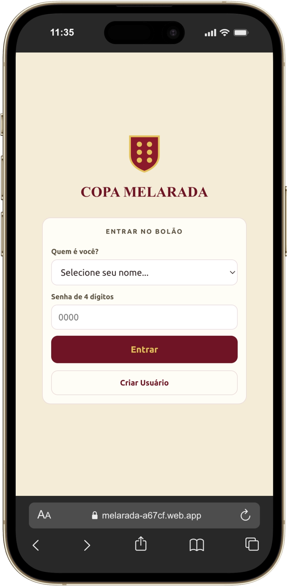
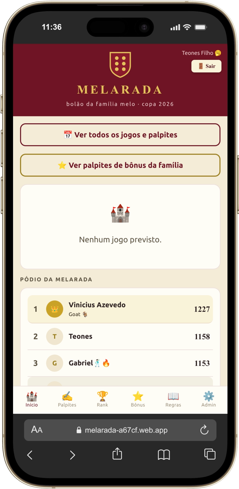
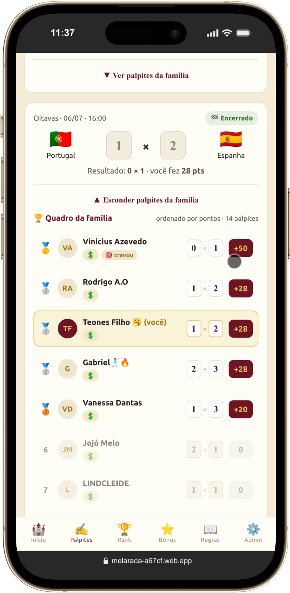

# Melarada

Bolão da Copa do Mundo 2026 para família e amigos. Cada participante dá palpites nos jogos, responde perguntas bônus e acompanha o ranking. O organizador lança resultados e gerencia o grupo.

<p>
  
  
  
</p>

**Demo:** https://melarada-a67cf.web.app

## Funcionalidades

- Cadastro com nome, PIN de 4 dígitos e código do grupo
- Palpites por partida
- Perguntas bônus
- Ranking com tendência de subida e descida
- Painel de organizador: jogos, resultados, gabarito e membros
- Página de regras e de perfil

## Stack

- React 19 + Vite
- Firebase: Firestore (dados), Auth anônimo e Hosting (deploy)

## Rodando localmente

```bash
npm install
npm run dev
```

O app usa um projeto Firebase próprio. Para rodar com o seu, crie um projeto com Firestore e Auth anônimo habilitados e troque a configuração em `src/services/firebase.js`.

## Deploy

```bash
npm run build
firebase deploy
```

## Decisões

- O primeiro usuário cadastrado vira organizador.
- Como o app é fechado (um grupo só), o login é por PIN simples, sem e-mail.